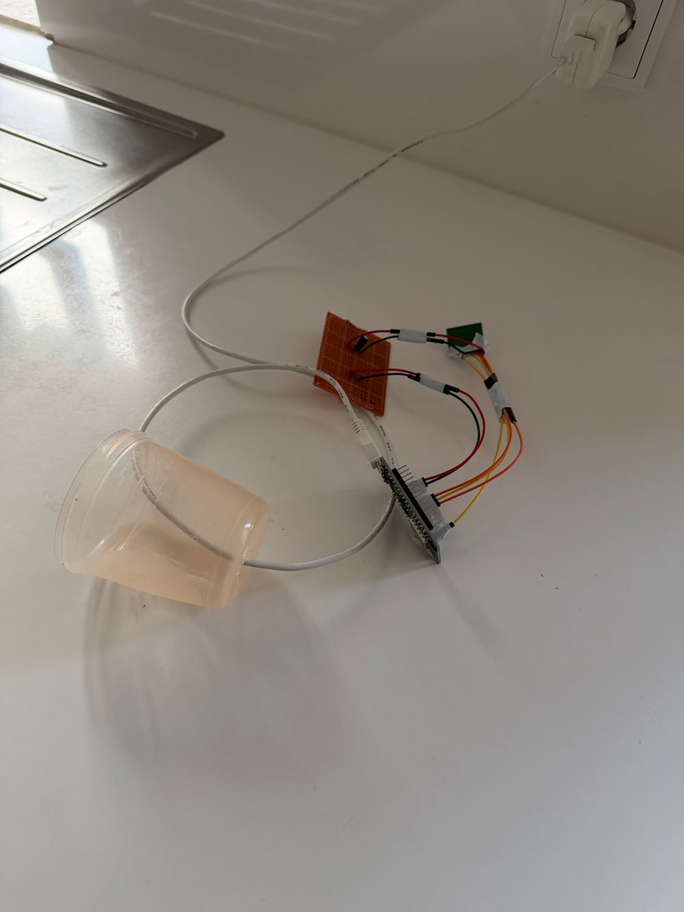

# DIY-Funkadapter für IKEA UTRUSTA und Home Assistant

Ersatz für eine defekte IKEA-UTRUSTA-Fernbedienung **E1205**. Ein USB-versorgter **NodeMCU V3 mit ESP8266** empfängt Befehle von Home Assistant per WLAN. Über vier SPI-Leitungen steuert er ein **TinyTronics CC2500, Artikel 002914**. Der Funkchip sendet die IKEA-Befehle direkt an die Leuchte. Zwei Kondensatoren sitzen auf einer kleinen Lochrasterplatine an der 3,3-V-Versorgung. Dies ist ein unabhängiges DIY-Projekt.

```text
Home Assistant ── WLAN / verschlüsselte ESPHome-API ── NodeMCU V3
NodeMCU V3 ── vier SPI-Leitungen ── CC2500 ── IKEA-Funk ── UTRUSTA
```

**Abnahme vom 21. November 2026.** ESPHome gebaut und per USB geflasht, CC2500 über SPI erkannt, vier Tasten in Home Assistant sichtbar. Der Betreiber hat die **Kopplung ohne Originalfernbedienung und Aus, Mittel und Voll an der Leuchte** bestätigt. Die Ein-Tasten-Rotation wurde in Home Assistant eingerichtet und die gespeicherte Konfiguration geprüft. Eine Live-Abnahme der Rotation, der Steckdosen und der Reichweite am endgültigen Standort ist nicht protokolliert. Die Alexa-Anbindung ist als Einrichtungsweg beschrieben. Ein Alexa-Test ist nicht protokolliert.



## Nachbauen und verstehen

| Schritt | Anleitung |
|---|---|
| 1. Teile identifizieren, Kondensatoren verlöten, Spannung messen und SPI verdrahten | [Hardware und Aufbau](docs/hardware.md) |
| 2. Quellcode, YAML, C++, Register und den Weg vom Build bis zum Flash verstehen | [Firmware und Werkzeugkette](docs/firmware.md) |
| 3. WLAN, SPI und Funk in der erprobten Reihenfolge in Betrieb nehmen | [Inbetriebnahme und Tests](docs/inbetriebnahme.md) |
| 4. Adapter, Tasten und Ein-Tasten-Rotation in Home Assistant einrichten | [Home Assistant und Alexa](docs/home-assistant.md) |

[Schaltplan als PNG](utrusta-schaltplan.png) · [Editierbarer Schaltplan als SVG](utrusta-schaltplan.svg) · [Lochrasterzeichnung](docs/bilder/kondensatoren-lochraster.png)

**Anschlussbelegung für Artikel 002914.** Mit sichtbarem Chip, Antenne oben und Stiften unten ist **Pin 1 links VCC** und **Pin 6 GND**. **CC2500-Pin 8 geht an NodeMCU D1**, nicht an D8. Frühe Skizzen aus dem Aufbau verwendeten eine andere Modulbelegung. Dieses Repository enthält den korrigierten Plan.

## Projektverlauf

| Phase | Was tatsächlich passiert ist |
|---|---|
| Ausgangspunkt | Die originale E1205 zeigte keine LED-Reaktion, und ihre Platine war korrodiert. Die UTRUSTA-Leuchten sollten bleiben, ebenso ihre Steckdosenversorgung. |
| Funklösung ausgewählt | RFLink mit Arduino Mega und Pegelwandlung war eine untersuchte Option. Gewählt wurde der kleinere WLAN-Aufbau mit ESP8266 und CC2500, weil Home Assistant direkt übers LAN anbinden kann. Das historische NodeMCU-Beispiel war eine Referenz für den Aufbau. Die eigene Senderkennung vermeidet, eine funktionierende Originalfernbedienung zum Auslesen zu brauchen. |
| Hardware beschafft | Zwei NodeMCUs, zwei CC2500 und Material für den Lochrasteraufbau bestellt. Der Betreiber dokumentierte die gelieferten Platinen per Foto. Der frühere Vergleichs-Pinout wurde nach Fund des Händlerbilds berichtigt. |
| Erstes Programm | Der Betreiber installierte den Device Builder, flashte die WLAN-Testfirmware und fügte das Gerät in Home Assistant hinzu. Der NodeMCU meldete eine LAN-IP und einen erfolgreichen Start. |
| Löten und Messen | Der Betreiber lötete die zwei Kondensatoren, zwei Brücken und vier Versorgungsleitungen, prüfte Spannung und Kurzschluss und verdrahtete die SPI-Signale. Die Dokumentation und der Schaltplan lieferten Zuordnung und Messpunkte. |
| Diagnose | Der SPI-Test meldete zunächst `00/00`. Die zweite Testfirmware zeigte beim Auswählen des Chips einen Timeout. Nach Umstecken von NodeMCU D8 auf **D1** las der Test `80/03`. |
| Funkfirmware | Der C++-Treiber und die YAML-Tasten wurden entwickelt, mit ESPHome 2026.8.0 kompiliert, per USB geflasht und mit den echten Startlogs geprüft. Der Betreiber lernte die Leuchte an und bestätigte Aus, Mittel und Voll. |
| Bedienung | In Home Assistant wurden eine Rotationstaste als Skript und ein Helfer für den nächsten Befehl eingerichtet. Alexa über dasselbe Skript ist als späterer Einrichtungsweg beschrieben. |

## Dateien für die Wiederherstellung

- [ESPHome-Gerätevorlage](utrusta-kueche.example.yaml) als `utrusta-kueche.yaml` speichern und die [Secrets-Vorlage](secrets.yaml.example) als `secrets.yaml` lokal ausfüllen.
- [SPI-Testpaket](cc2500-spi-test.yaml) zum Auslesen der Chipkennung ohne Funk.
- [IKEA-Firmwarepaket](packages/utrusta-radio.yaml) mit [C++-Funklogik](packages/utrusta_radio.h) und eigener Senderkennung aus `secrets.yaml`.
- [Home-Assistant-Skript](home-assistant/utrusta_licht_weiterschalten.yaml) für **Aus → Mittel → Voll**. Der Helfer und die Importreihenfolge sind im [Home-Assistant-Kapitel](docs/home-assistant.md) beschrieben.
- [Eigene Zeichnungen und Fotos mit Quellen](docs/bilder/README.md).

Die persönliche `secrets.yaml`, die aktive Geräte-YAML und Firmware-Binärdateien bleiben lokal. Zum Restore der bestehenden Installation den bisherigen Gerätenamen, den API-Schlüssel und die Senderkennung übernehmen. Die Firmware enthält die Zugangsdaten aus dem Build und wird daher aus den Vorlagen und dem Quellcode lokal neu erzeugt.

## Lizenz

Der eigene Firmwarecode und die YAML-Konfigurationen stehen unter [GNU GPLv3](LICENSE). Das umfasst die ESPHome-Pakete, die ESPHome-Vorlagen und das Home-Assistant-Skript. Für Fotos, Zeichnungen und Markdown-Text gilt diese Lizenzfreigabe nicht. Verlinkte Projekte behalten ihre eigenen Rechte und Lizenzbedingungen. Der Treiber implementiert das dokumentierte Protokoll und nutzt technische Register- und Telegrammwerte aus den verlinkten Referenzen. [Lizenz der ESPHome-Laufzeit](https://github.com/esphome/esphome/blob/2026.8.0/LICENSE)
