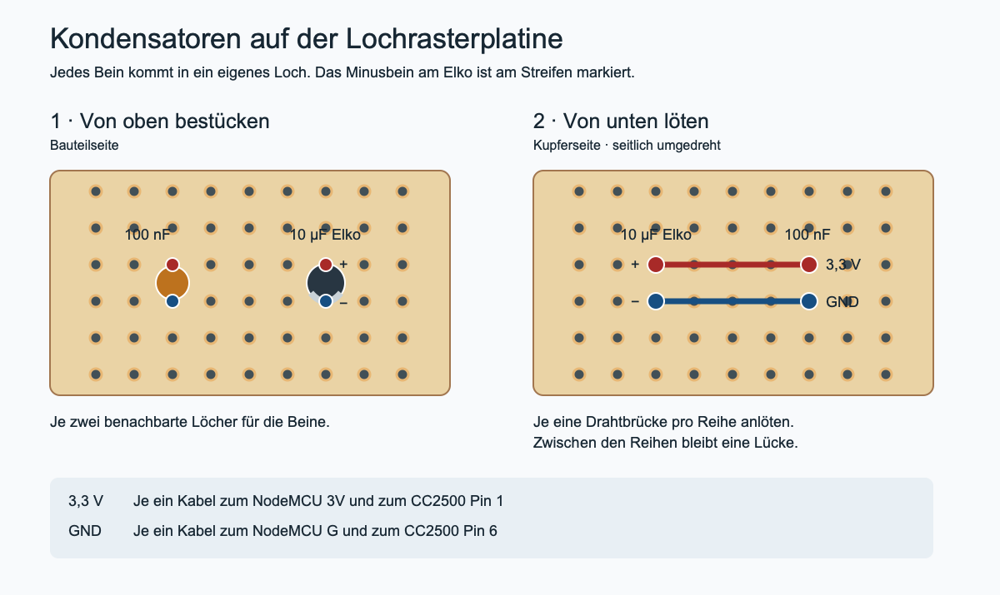
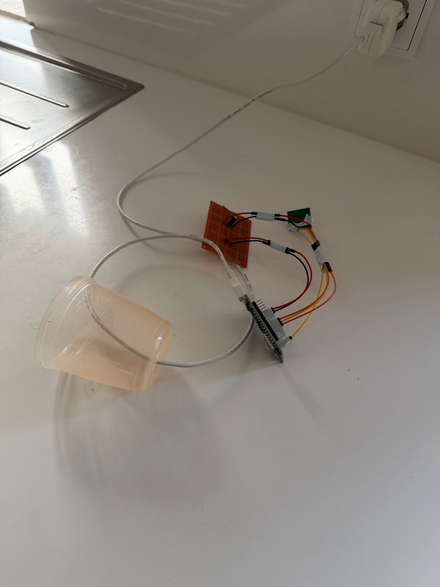
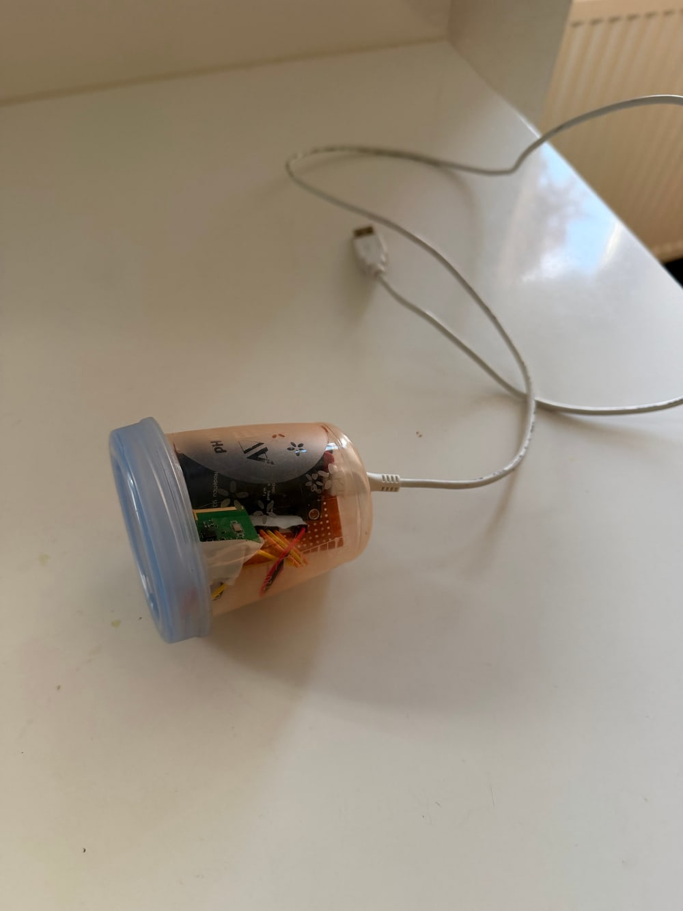

# Hardware, Verdrahtung und Aufbau

Der USB-versorgte Adapter ersetzt die defekte runde, weiße **IKEA UTRUSTA E1205**. Auf dem Typenschild der Fernbedienung standen zudem `21334` und **2 × AAA/LR03 à 1,5 V**. Ihre LED blieb aus. Auf der Platine war Korrosion sichtbar. Für den Funkadapter wird kein Bauteil der Originalfernbedienung benötigt. An der IKEA-Netzinstallation wird für diesen Aufbau nichts umverdrahtet. Der an der Leuchte verwendete Lernknopf ist von außen zugänglich.

## 1. Bauteile, Mengen und Werkzeug

| Bestellt oder vorhanden | Pro Adapter | Zweck und Erkennung |
|---|---:|---|
| 2 × BerryBase **NodeMCU V3 ESP8266** (`NMCUV3`, als CH340G-Board verkauft) | 1 | Schwarze Platine mit Micro-USB und ESP-12E-Modul. Der ESP8266 führt die Firmware aus, verbindet sich mit WLAN und stellt `3V` bereit. Die Rückseite des fotografierten Boards nennt CH340C als USB-Seriell-Treiberhinweis. |
| 2 × TinyTronics **CC2500, Artikel 002914** | 1 | Kleine grüne Funkplatine mit acht Stiften und goldener Leiterplattenantenne. Der CC2500 sendet die IKEA-Telegramme. |
| 1 × Dupont-Set, 10 cm, Buchse–Buchse, Stift–Stift und Stift–Buchse | 1 Set | Für die vier Versorgungsabschnitte reichen zwei halbierte Buchse–Buchse-Leitungen. Vier weitere kurze Leitungen führen die SPI-Signale. Zwei Drahtreste dienen als Brücken. |
| 3 × bedrahtete Keramikkondensatoren, **100 nF, 50 V** | 1 | Kleines, ungepoltes Bauteil. Puffert schnelle Änderungen der Versorgung. Beide Beine sind gleichwertig. |
| 3 × radiale Elektrolytkondensatoren, **10 µF, 50 V** | 1 | Größeres, gepoltes Bauteil. Der Minusstreifen markiert das Minusbein. Puffert die Versorgung zusätzlich. |
| 2 × BerryBase **PBS-5X7**, Lochraster 50 × 70 mm, einseitige Kupferauflage | 1 Platine oder Teilstück | Jede Bohrung hat einen eigenen Kupferring. Die Platine trägt die Kondensatoren, zwei Drahtbrücken und die vier Versorgungsanschlüsse. |
| Entlötlitze, Breite 1,0 mm | bei Bedarf | Nimmt überschüssiges Lötzinn oder versehentliche Zinnbrücken auf. |
| Micro-USB-Datenkabel und USB-Netzteil | je 1 | Datenkabel vom Mac zum NodeMCU für Firmware und Log. Netzteil für den Betrieb in der Küche. |

Das zweite Modulpaar stand als Reserve zur Verfügung. Für den Aufbau wurden Lötkolben, Elektroniklötzinn, Multimeter, Seitenschneider und Abisolierwerkzeug verwendet oder benötigt. Eine Lupe oder Handy-Makrokamera hilft bei der Kontrolle der acht eng stehenden Stifte. Dünner Schrumpfschlauch schützt Lötstellen bei direkt angelöteten Drähten. [NodeMCU](https://www.berrybase.de/nodemcu-v3-esp8266-development-board-ch340g) · [Funkmodul 002914](https://www.tinytronics.nl/en/communication-and-signals/wireless/rf/modules/cc2500-wireless-rf-module-2.4ghz) · [Jumper-Set](https://www.berrybase.de/40pin-jumper-dupont-kabel-set-je-1x-f-f-m-m-f-m-10cm) · [100 nF](https://www.berrybase.de/keramikkondensator-100nf-50v-10-tht-2-54mm) · [10 µF](https://www.berrybase.de/elektrolytkondensator-10-f-50v-1050c-1-radial-tht) · [Lochrasterplatine](https://www.berrybase.de/lochrasterplatine-5x7cm-mit-einseitiger-kupferauflage)

## 2. Orientierung und verbindliche Pinbelegung

Der [NodeMCU auf der Bauteilseite](bilder/nodemcu-bauteilseite.jpg) zeigt die Aufdrucke `D1`, `D5`, `D6`, `D7`, `G` und `3V`. Für die Versorgung wurde das `G` neben `D5` und das `3V` neben diesem `G` gewählt. Der Spannungsregler auf dem NodeMCU macht aus der USB-Versorgung die vom CC2500 benötigte 3,3-V-Spannung. Am Funkmodul kommt die Versorgung an dessen `VCC`. Dafür darf nur der 3,3-V-Ausgang des NodeMCU verwendet werden.

Halte den [CC2500 auf der Bauteilseite](bilder/cc2500-bauteilseite.jpg) mit **sichtbarem schwarzen Chip**, **goldener Antenne oben** und **acht Stiften unten**. Zähle **von links nach rechts**. Auf der [Rückseite](bilder/cc2500-unterseite.jpg) ist diese Reihenfolge gespiegelt. Die Herstellerplatine ist laut Händler rund **24 × 19 mm** groß, ihr Stiftraster **2,0 mm**. Bei üblichen 2,54-mm-Dupontbuchsen stoßen die Kunststoffgehäuse benachbarter Kabel leicht aneinander. [Eigene Pinzeichnung](bilder/cc2500-pinbelegung.png) · [Maßskizze](bilder/cc2500-abmessungen.png)

| CC2500-Pin | Signal am Modul | NodeMCU | Kabelweg |
|---:|---|---|---|
| **1**, ganz links | **VCC, 3,3 V** | `3V` | Über die rote Brücke auf dem Lochraster. |
| 2 | SI / MOSI | `D7` / GPIO13 | Direkt. Daten vom ESP zum Funkchip. |
| 3 | SCLK | `D5` / GPIO14 | Direkt. Takt vom ESP. |
| 4 | SO / MISO | `D6` / GPIO12 | Direkt. Daten und Bereitschaftssignal vom Funkchip. |
| 5 | GDO2 | frei | Kein Kabel. |
| **6** | **GND** | `G` | Über die schwarze Brücke auf dem Lochraster. |
| 7 | GDO0 | frei | Kein Kabel. |
| **8**, ganz rechts | CSn | **`D1` / GPIO5** | Direkt. LOW wählt den CC2500 aus. |

Für die acht Modulstifte gilt die obige Belegung. Das TI-Datenblatt beschreibt die Kontakte des aufgelöteten Chips. [Schaltplan](../utrusta-schaltplan.png) · [TI-Datenblatt](https://www.ti.com/lit/ds/symlink/cc2500.pdf)

## 3. Die Kondensatoren auf Lochraster löten



1. **USB abziehen.** Die Platine mit der Bauteilseite nach oben hinlegen. Je zwei Löcher im Beinabstand markieren. Die vier Löcher bilden zwei Reihen. Eine Reihe steht für **3,3 V**, die andere für **GND**. Für eine kleine Kondensatorplatine kann man ein Teilstück mit feiner Säge abtrennen. Vorher Platz für Bauteile, Kabel und eine Befestigung einplanen. Nach dem Sägen Kanten entgraten und Kupferreste entfernen.
2. **Kondensatoren von oben einsetzen.** Jedes Bein bekommt ein eigenes Loch. Der kleine Keramikkondensator kann in beide Richtungen hinein. Beim großen 10-µF-Elko kommt das Bein am aufgedruckten **Minusstreifen** in die Masse-Reihe. Das längere, ungekürzte Bein ist üblicherweise Plus und gehört in die 3,3-V-Reihe. Nach dem Kürzen am Streifen orientieren.
3. **Vier einzelne Lötstellen setzen.** Die Platine seitlich umdrehen. Auf der Kupferseite das Bein und seinen Kupferring zusammen kurz mit der Spitze erwärmen und etwas Lötzinn zuführen. Das Bein beim Abkühlen ruhig halten. Danach sind beide Kondensatoren befestigt. Alle vier Kupferpunkte sind noch voneinander getrennt.
4. **Zwei Drahtbrücken anlöten.** Zwei kurze isolierte Drahtstücke an beiden Enden jeweils 2–3 mm abisolieren und dünn verzinnen. Unten je eine Brücke direkt an beide Kondensator-Lötpunkte **derselben Reihe** löten. Ein Ende pro Lötstelle reicht. Wenn ein Draht in einem eigenen Loch sitzt, muss sein Kupferring mit dem benachbarten gewünschten Lötpunkt verbunden werden. Die beiden Reihen dürfen sich nicht berühren.
5. **Vier Versorgungsenden anbringen.** Ein rotes und ein schwarzes Buchse–Buchse-Kabel halbieren, jede Schnittseite abisolieren und verzinnen. Je ein rotes Kabelende an beide Enden der roten Brücke löten. Je ein schwarzes an beide Enden der schwarzen. Die Buchsen bleiben frei, wenn sie aufgesteckt werden. Am CC2500 können die Buchsen bei Bedarf abgeschnitten und die Drähte direkt an den Modulpin gelötet werden.

```text
NodeMCU 3V ────●══════════════●──── CC2500 Pin 1 (VCC)
               │              │ +
             100 nF         10 µF
               │              │ −
NodeMCU G  ────●══════════════●──── CC2500 Pin 6 (GND)
```

Die Gleichspannung erreicht das Funkmodul über die beiden **Brücken**. Die Kondensatoren hängen **parallel** dazwischen, mit je einem Bein an jeder Reihe. Wo an derselben Brücke das vom NodeMCU kommende Kabel sitzt, ist elektrisch gleichwertig. Am gebauten Adapter führt Rot vom NodeMCU zum Lötpunkt beim kleinen Kondensator, über die rote Brücke zum Plus des Elkos und weiter zu Pin 1. Schwarz führt entsprechend über die GND-Reihe und den Minuspol des Elkos zu Pin 6.

## 4. Messen und verdrahten

### Widerstand bei abgezogenem USB

1. Schwarz ins Multimeter an `COM`, Rot an `V/Ω`. Den **200-Ω-Bereich** wählen. Direkt zusammengehaltene Spitzen zeigten beim verwendeten Gerät **`00.7` Ω**. Mit getrennten Spitzen zeigte es **`1`** für Messbereichsüberschreitung.
2. An der Kondensatorplatine von einem Ende der roten Brücke zum anderen messen, danach Schwarz wiederholen. Erwartet wird ungefähr der Vergleichswert der zusammengehaltenen Spitzen. Zwischen Rot und Schwarz kann sich die Anzeige kurz verändern, während die Messspannung die Kondensatoren lädt. Ein dauerhaft fast so niedriger Widerstand wie bei kurzgeschlossenen Spitzen deutet auf eine Brücke zwischen den Reihen hin.
3. Den losen CC2500 zwischen **Pin 1 und Pin 6** auf einen Kurzschluss prüfen. Kurze Schwankungen können beim Laden der Kondensatoren auftreten. Ein dauerhaft niedriger Wert nahe dem Vergleichswert der Messspitzen deutet auf einen Kurzschluss hin.

### Spannung und SPI

1. Den **NodeMCU allein per USB** versorgen. Das Multimeter auf Gleichspannung `V⎓` stellen. Bei manueller Bereichswahl **20 V** wählen. Schwarz an `G` und Rot an `3V`. Gemessen wurden **+3,31 V**. USB wieder abziehen.
2. Rot über die Kondensatorplatine vom NodeMCU-`3V` zu CC2500-Pin 1 verbinden, Schwarz vom NodeMCU-`G` zu Pin 6. Vor dem Einschalten zwischen den Reihen nochmals auf Kurzschluss prüfen.
3. Nur mit der Versorgung verdrahtet einschalten. Am Funkmodul in `V⎓` messen, Schwarz an Pin 6 und Rot an Pin 1. Ziel sind rund **+3,3 V**. Jede Messspitze muss nur ihren eigenen Stift berühren.
4. USB erneut abziehen. Die vier direkten Signalwege **Pin 2 → D7**, **Pin 3 → D5**, **Pin 4 → D6** und **Pin 8 → D1** herstellen. Jeder Weg kann vom Metall am NodeMCU bis zum Stift am Funkmodul auf Durchgang geprüft werden.
5. Unter Licht auf Zinnbrücken und überstehende Litzen prüfen. Dann USB verbinden und den [SPI-Lesetest](inbetriebnahme.md#5-spi-diagnose) starten.

## 5. Enge Stifte löten und Leitungen entlasten

Am Funkmodul waren die Steckverbindungen fragil. Für einen festen Anschluss können kurze isolierte Drähte direkt an die Stifte gelötet werden. Die Buchsen auf der NodeMCU-Seite können steckbar bleiben.

1. Das stromlose Modul auf einer hitzefesten Unterlage fixieren. Nur am CC2500-Ende die Buchse abschneiden und rund **1–2 mm** Draht abisolieren. Litzen zusammendrehen und mit wenig Zinn vorverzinnen. Bei Schrumpfschlauch diesen vor dem Löten auf das Kabel schieben.
2. Einen einzelnen Draht längs an das freie Ende des Stifts halten. Stift und Draht kurz gemeinsam erwärmen, bis das Zinn beide benetzt. Den Kolben wegnehmen und das Kabel stillhalten. Pin 8 außen ist ein sinnvoller erster Anschluss zum Üben.
3. Die Lötstelle seitlich im Licht ansehen. Zwischen Nachbarstiften soll ein Spalt sichtbar bleiben. Eine versehentliche Brücke mit Entlötlitze und kurzer Hitze aufnehmen. Nach jedem Draht die Verbindung und die Nachbarpins kontrollieren.
4. Das Kabelbündel mit etwas Spiel an der Lochrasterplatine oder einem nichtleitenden Träger befestigen. Die Antenne frei halten. Kupferringe und Lötstellen gegen Kontakt mit Metall schützen. Wenn das Modul regelmäßig lösbar bleiben soll, passt eine achtpolige Buchsenleiste im **2,0-mm-Raster**.
5. Nach dem Befestigen die Kurzschluss-, Spannungs- und SPI-Prüfung wiederholen. Die Fotos zeigen eine provisorische Unterbringung aus transparentem Kunststoff.

## Fotos des aufgebauten Adapters





Die Fotos zeigen den offenen Aufbau und die provisorische Unterbringung. Der USB-Anschluss bleibt von außen erreichbar.
